<picture>
  <source media="(prefers-color-scheme: dark)" srcset="./assets/arcade-dark.svg" />
  
</picture>

## 🕹️ Story mode

I build full-stack applications. Currently finishing my B.E. in Computer Science at Jadavpur University.

## 🏆 High scores

| RANK | SCORE | ACHIEVEMENT |
|:---:|:---:|---|
| 1ST | **18** | Projects Shipped |
| 2ND | **7.7/10** | GPA at Jadavpur University |
| 3RD | **98.6%** | Class 12 JKBOSE |
| 4TH | **Jan–May 2026** | Louisa AI Internship |

## 🗺️ Levels

### 🟨 LEVEL 1 · Louisa AI (in progress)

*Software Engineer Intern · Jan 2026 – May 2026*

- Implemented the GitHub integration for an internal release automation platform
- Developed APIs to interact with GitHub workflows, with Slack notifications

## ⚔️ Quests

| Quest | Objective | Loot | Gear |
|-------|-----------|------|------|
| **contextforge** | Self-hostable RAG answer bot that cites sources and abstains when unsure | Streaming chat UI, embeddable widget, and golden-set eval harness measuring hallucination and abstain behavior | Next.js 15, TypeScript, Drizzle ORM, pgvector, PostgreSQL, Vercel AI SDK, Tailwind |
| **enterprise-employee-portal** | HR self-service portal | Two-stage leave approval, org chart, Jenkins pipeline gated on Newman tests | Angular 18, Express, MySQL, TypeScript, Newman, Docker Compose |
| **tokenforge** | Design-token source of truth for consistent UI theming | Forged into Tailwind, CSS variables (light/dark/high-contrast), and typed TypeScript with WCAG contrast gate that fails CI before a bad pair ships | Node.js, TypeScript, Tailwind CSS, Zod, Vitest, GitHub Actions |
| **resumable** | Server-sent events with reliable reconnection | Real Last-Event-ID contract over bounded replay buffer and explicit GAP signal so reconnecting clients never silently skip events | Fastify, React, Redis, TypeScript, Vitest |
| **sessionprops** | Session security testing framework | Invariants checked with stateful property-based testing that generates and shrinks adversarial login, elevate, rotate and logout sequences | Express, Redis, TypeScript, fast-check, Vitest |
| **E-Commerce Store** | Full-stack e-commerce platform | Optimized performance using Redis, managed media with Cloudinary, integrated payments via Stripe | MERN Stack, Zustand, Redis, Cloudinary, Stripe, JWT, Tailwind CSS |

Walkthrough: contextforge

@@

## 🎒 Inventory

  

## 👾 Press start

[**EMAIL**](mailto:mariammalik5100@gmail.com) · [**GITHUB**](https://github.com/itzzshut)

## 🕹️ Projects

- [build-a-recommendation-engine-example-with-spring-boot-and-aerospike](https://github.com/itzzshut/build-a-recommendation-engine-example-with-spring-boot-and-aerospike) — Personal development project using industry best practices
- [real-time-financial-analysis-trading-system](https://github.com/itzzshut/real-time-financial-analysis-trading-system) — Full-featured application built as a learning exercise
- [real-time-fraud-detection](https://github.com/itzzshut/real-time-fraud-detection) — Practice repository for exploring advanced features
- [contextforge](https://github.com/itzzshut/contextforge) — A self-hostable RAG answer bot that cites its sources and abstains when unsure, with a streaming chat UI, an embeddable widget, and a golden-set eval harness…
- [pulseboard-ops](https://github.com/itzzshut/pulseboard-ops) — Early-stage startups need to watch business-critical events (failed payments, deploy errors, signup spikes) across tools in real time, but…
- [resumable](https://github.com/itzzshut/resumable) — Server-sent events with a real Last-Event-ID contract over a bounded replay buffer and an explicit GAP signal, so reconnecting clients never silently skip…
- [tokenforge](https://github.com/itzzshut/tokenforge) — One design-token source of truth, forged into Tailwind, CSS variables (light/dark/high-contrast), and typed TS — with a WCAG contrast gate that fails CI before…
- [sessionprops](https://github.com/itzzshut/sessionprops) — Session security expressed as invariants and checked with stateful property-based testing that generates and shrinks adversarial login, elevate, rotate and…
- [enterprise-employee-portal](https://github.com/itzzshut/enterprise-employee-portal) — An Angular 18 HR self-service portal on an Express and MySQL REST API, with two-stage leave approval, timesheets, an org chart and a Jenkins pipeline gated on…
- [traceboard](https://github.com/itzzshut/traceboard) — Requirements traceability tool that links requirements, tests, code, and defects, and flags stale coverage where a test passes against a requirement that has…
