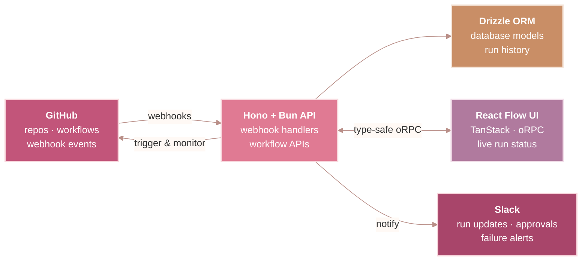
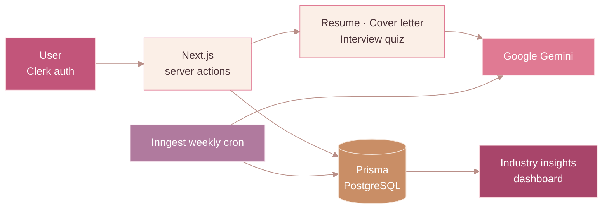
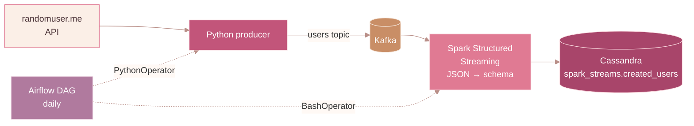
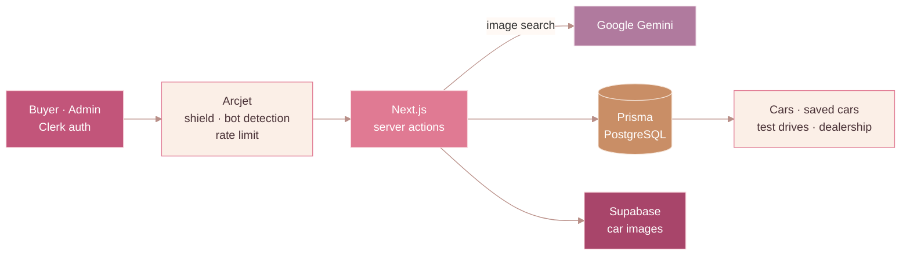
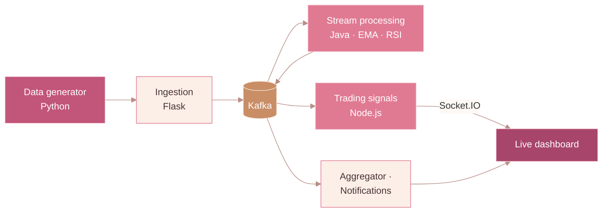

<!--
  Palette "Rose Noir" (used everywhere): deep wine cards lit by pink and peach glows
    base #1C0A13 → #38142A · panel #2A1120 · border #6E2F4C · rose #F48FAB · blush #F9C3D1
    pink #F2A7B8 · peach #EDB98F · mauve #CFA0C8 · text #F6E7E1 · muted #C49DA4
  The card-*.svg images are rebuilt daily from live GitHub data by
  .github/workflows/profile-cards.yml (scripts/build_profile_cards.py) into the "cards" branch.
-->

     

---

## 👩‍💻 About Me

**Full-Stack Developer** &nbsp;🌸&nbsp; **Type-safe Web Apps** &nbsp;💗&nbsp; **Workflow Automation** &nbsp;🤎&nbsp; **AI-powered Products**

Software engineer and **Computer Science & Engineering** graduate from **Jadavpur University** (May 2026). Most recently a **Software Engineer Intern at Louisa AI**, where I owned the **GitHub integration phase** of an internal release automation platform end to end: backend services, database models, webhooks, workflow APIs, Slack notifications and the React Flow frontend, all on a type-safe **React · TanStack · Hono · Bun · Drizzle · oRPC** stack. On the side I build full-stack products with **Next.js, Node.js, Prisma and MongoDB**, and I've solved **800+ DSA problems**.

- 🔭 **Building:** full-stack apps with end-to-end type safety
- 🌱 **Exploring:** event-driven backends, workflow orchestration and AI-powered features
- 💬 **Ask me about:** React, Next.js, Node.js, Hono, Bun, Prisma, Drizzle, MongoDB, PostgreSQL and DSA

---

## 🖥️ Profile Scan

  

---

## ✨ At a Glance

  

---

## 💼 Experience

<b>Software Engineer Intern · Louisa AI</b> &nbsp;|&nbsp; Jan 2026 – May 2026 &nbsp;|&nbsp; Remote &nbsp;(click to collapse)

 

An internal **release automation platform** that streamlines deployment workflows across engineering teams. I worked on the **GitHub integration phase** end to end:

| Focus | What I did |
|:--|:--|
| 🔗 **GitHub integration** | Built the GitHub integration phase end to end: **backend services, database models, webhooks and frontend components** |
| ⚙️ **Workflow APIs** | Developed APIs that interact with **GitHub workflows** to run and monitor deployment processes automatically |
| 🔔 **Slack notifications** | Integrated **Slack** for real-time updates on workflow runs, approvals and failure handling |
| 🛡️ **Type-safe full stack** | Shipped features on **React, React Flow, TanStack, Hono, Bun and Drizzle ORM** with compile-time safe client-server contracts via **oRPC** |

`React` `React Flow` `TanStack` `Hono` `Bun` `Drizzle ORM` `oRPC` `GitHub Actions` `Webhooks` `Slack API`

  

---

## 🛠️ Tech Stack

  

  

---

## 🚀 Featured Projects

  

<b>🤖 AI Career Coach</b> &nbsp;—&nbsp; AI career guidance with Google Gemini &nbsp;·&nbsp; <a href="https://sensai-liart.vercel.app">live demo</a> &nbsp;·&nbsp; <a href="https://github.com/itzzshut/sensai">repo</a>

 

Full-stack career coaching platform. After **Clerk** sign-in and onboarding, users get an industry insights dashboard, an AI **resume builder**, AI **cover letters** and **mock interview quizzes** with performance tracking. Next.js server actions call **Google Gemini** and persist results through **Prisma** on PostgreSQL. An **Inngest** cron job refreshes salary ranges, demand and skill trends for every industry each week.

`Next.js` `React` `Node.js` `Prisma` `PostgreSQL` `Clerk` `Inngest` `Google Gemini` `ShadCN` `Tailwind`

<b>⚡ Spark · Kafka · Cassandra Streaming Pipeline</b> &nbsp;—&nbsp; real-time API → Kafka → Cassandra &nbsp;·&nbsp; <a href="https://github.com/itzzshut/spark-kafka-cassandra-pipeline">repo</a>

 

End-to-end streaming data pipeline. A Python producer pulls user records from the **randomuser.me API** and publishes them to a **Kafka** `users` topic. A **Spark Structured Streaming** job reads the topic, parses the JSON against a typed schema and writes each record into a **Cassandra** table. **Airflow** schedules the run as a daily DAG (a PythonOperator for the producer, a BashOperator for the Spark job), and the whole cluster runs in **Docker Compose**.

`Python` `Apache Kafka` `Spark Structured Streaming` `PySpark` `Cassandra` `Airflow` `Docker Compose`

<b>🚗 Vehiql</b> &nbsp;—&nbsp; AI car marketplace with image search &nbsp;·&nbsp; <a href="https://github.com/itzzshut/Vehiql">repo</a>

 

Car marketplace built on **Next.js**. Users browse and save cars, search by uploading a photo (**Google Gemini** identifies the car from the image) and book **test drives**. An admin panel manages listings, test-drive bookings and dealership hours. **Clerk** handles auth, **Prisma** stores data in PostgreSQL, **Supabase** stores car images, and **Arcjet** adds bot detection, attack shielding and rate limiting.

`Next.js` `React` `Prisma` `PostgreSQL` `Supabase` `Clerk` `Arcjet` `Google Gemini` `ShadCN` `Tailwind`

<b>📈 Real-Time Financial Analysis & Trading System</b> &nbsp;—&nbsp; Kafka microservices for live trading signals &nbsp;·&nbsp; <a href="https://github.com/itzzshut/real-time-financial-analysis-trading-system">repo</a>

 

Event-driven microservices pipeline. A generator streams market data into a Flask ingestion service, which publishes it to **Kafka**. A Java stream processor computes **EMA and RSI** per symbol, and a Node.js service turns them into buy/sell **trading signals** that stream to a live dashboard over **Socket.IO**, alongside aggregation and notification services. Every service ships with a Dockerfile and **Kubernetes** manifests.

`Kafka` `Java` `Node.js` `Socket.IO` `Python` `Flask` `Docker` `Kubernetes`

---

## 📊 GitHub Stats

---

## 🎓 Education

| | **Program** | **Institution** | **Result** | **Year** |
|:-:|:----------|:---------------|:---------:|:------:|
| 🎓 | **B.E. in Computer Science & Engineering** | Jadavpur University, Kolkata | GPA **7.7 / 10** | May 2026 |
| 🏫 | **Class XII (JKBOSE)** | Happy Model School, Udhampur, J&K | **98.6%** | Apr 2022 |

Relevant coursework: `Data Structures` `OOP` `Operating Systems` `DBMS`

---

## 🏆 Achievements

     

---

## 🤝 Let's Connect

I'm open to **full-stack and backend software engineering roles**. Let's build something together! 🌸

    

